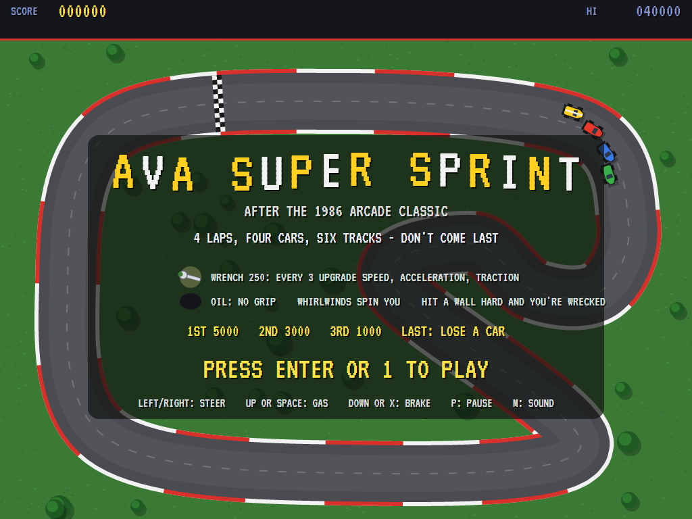
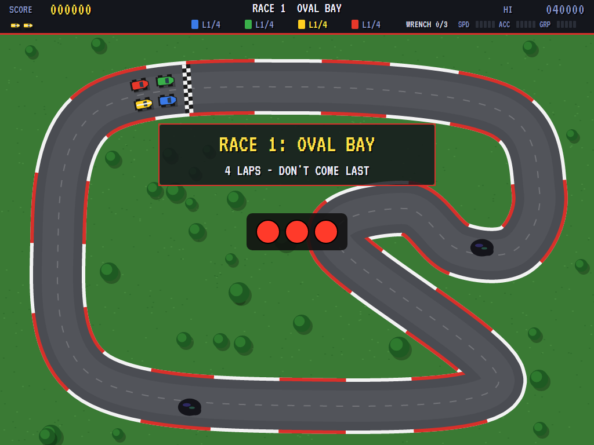
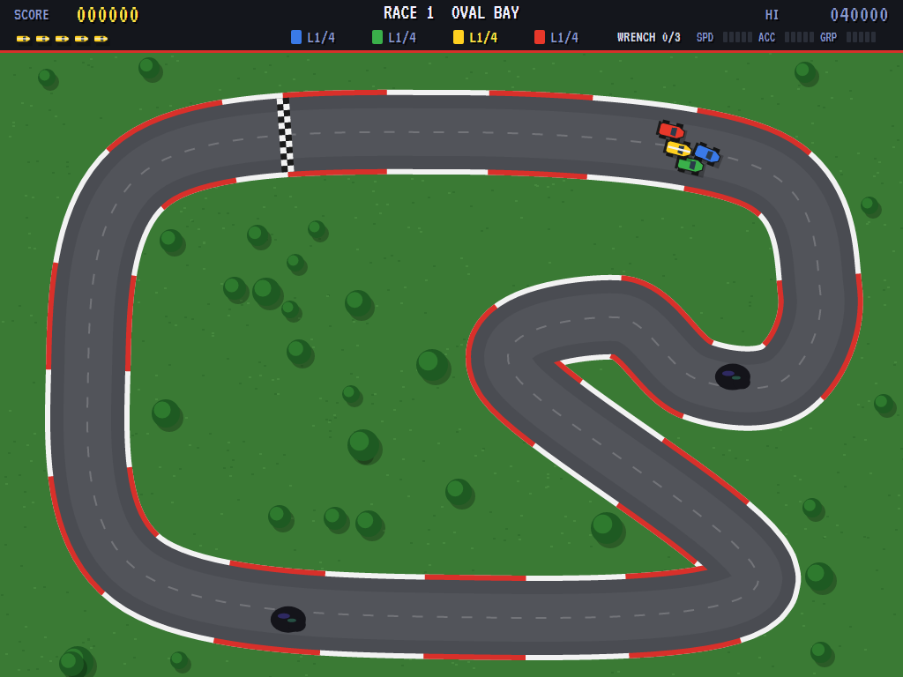
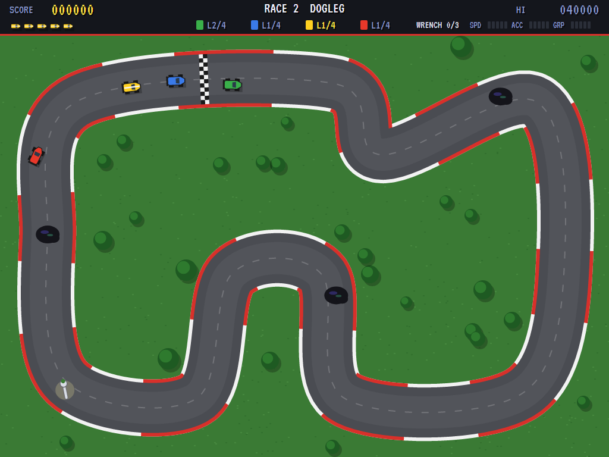
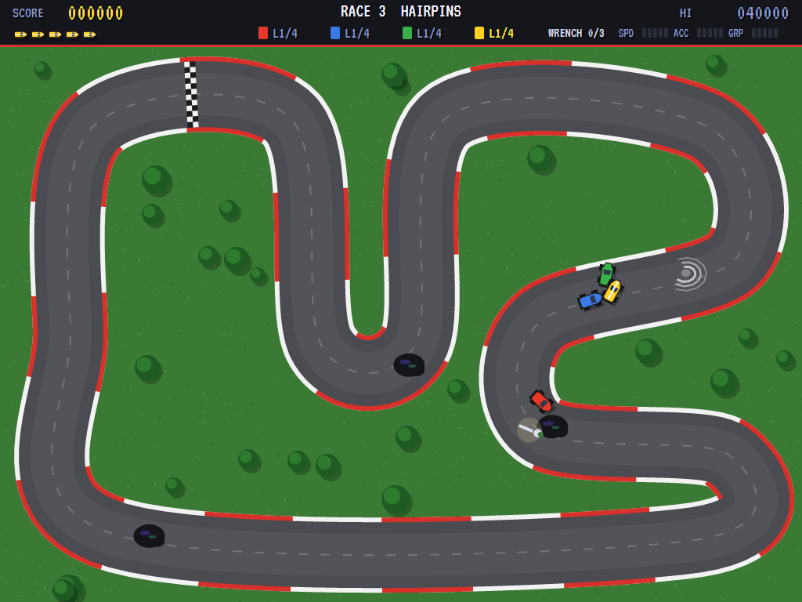
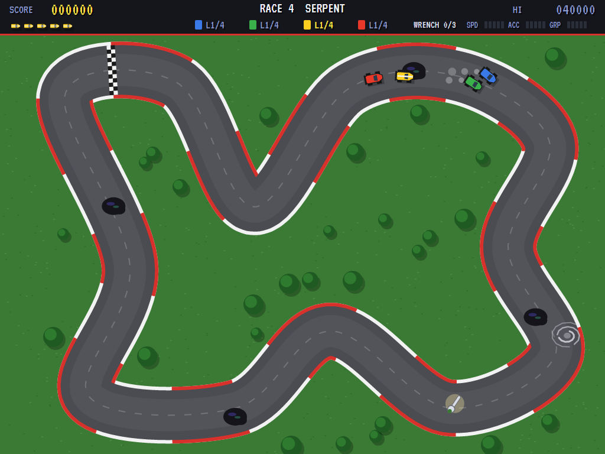
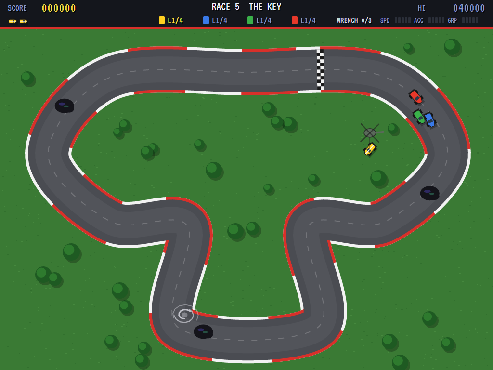
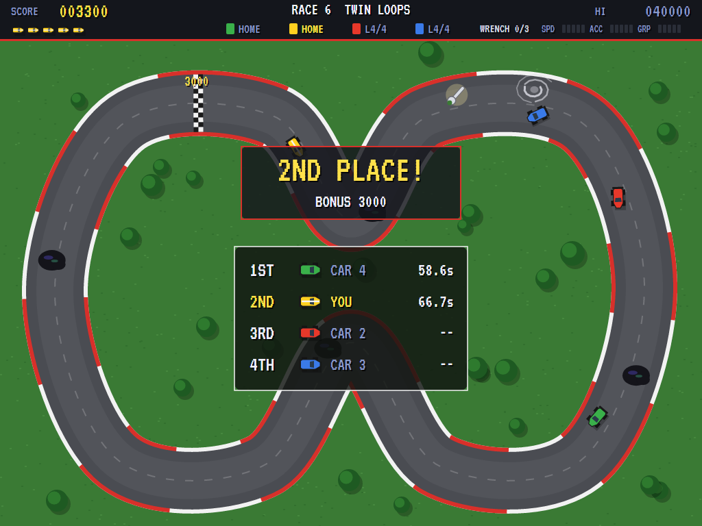
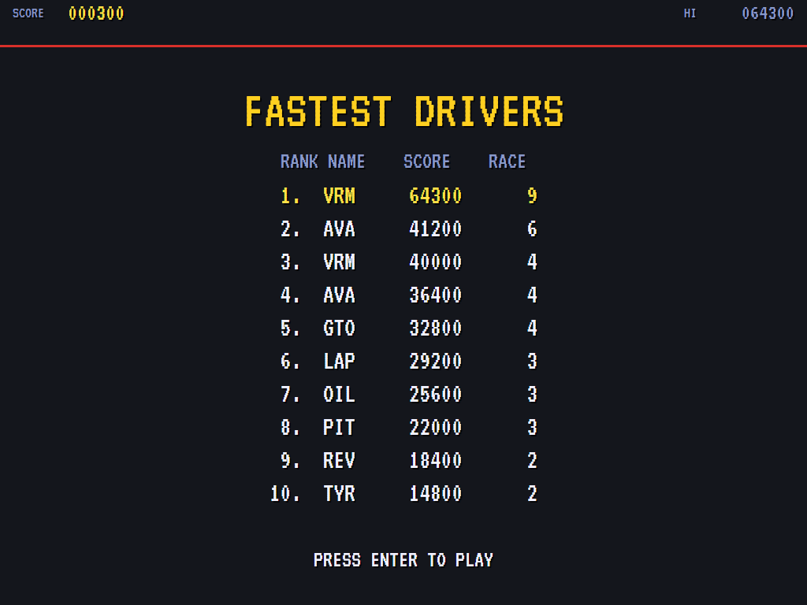

# AVA Super Sprint

[](https://github.com/Harlock123/AVASuperSprint/actions/workflows/build.yml)

An overhead racing game in the style of Atari's 1986 arcade game **Super Sprint**, built with .NET 10 and
Avalonia UI. Four little sprint cars race four laps of a track seen whole from above: yours and three
computer cars. Steer round the bends, mind the oil, and pick up wrenches to upgrade your car. Hit a wall
too hard and you're wrecked until the helicopter brings you a new car. Come last and it costs you a car.

## Features

- **Six tracks** in turn: **Oval Bay**, **Dogleg**, **Hairpins**, **Serpent**, **The Key** and **Twin
  Loops**. Each is a smooth loop that fills the screen, with red-and-white kerbs and a chequered start line.
  The tests check that none of them ever comes close to crossing itself.
- **The cars** have momentum. The gas takes you up to top speed, and off it you roll to a stop. The brake
  is far quicker. Steering bites harder the faster you go, and grip kills the slide: corner too fast and
  the back steps out, with tyre smoke behind you.
- **Walls**: glance off one and you lose speed. Go into one hard and the car is wrecked. A helicopter flies
  in with a fresh one and sets it down in the middle of the road, which costs you time but not a life.
- **Hazards:**
  - **Oil slicks**, two to four a track, take away almost all your grip for a moment.
  - **A whirlwind**, from the third race on, wanders back round the track the wrong way and spins any car
    it catches.
- **Wrenches** (250) turn up on the road one at a time. Every third one upgrades your car: **top speed**,
  **acceleration** and **traction** in turn, up to five steps each. Upgrades carry over from race to race.
  The computer cars can drive over a wrench before you get to it.
- **Each race** starts on the grid with three red lights, and you start at the back. Finishing pays 5,000
  for 1st, 3,000 for 2nd and 1,000 for 3rd. **Last costs a car**, and so does still being out there 15
  seconds after the others are home. The computer cars get quicker every race. You start with three cars.
- **The attract mode** races itself. The computer driver aims at a point up the road (further ahead the
  faster it goes), steers for it, and keeps to a speed the bends ahead allow, braking in time. It goes a
  little off its line for a wrench. The three rival cars drive the same way, each in its own lane.
- **The sounds** are all synthesised: the lights' beeps, tyre squeal, bumps, crashes, the helicopter,
  wrench chimes, lap bells, and a rock-and-roll riff over four buzzing engines.

## Screenshots

| The title | The lights | The first corner |
|:---------:|:----------:|:----------------:|
|  |  |  |
| Oval Bay behind the rules. | Three reds on the grid. | Away from the line. |

| Dogleg | A whirlwind | Oil |
|:------:|:-----------:|:---:|
|  |  |  |
| A wrench out on the road. | Hairpins, with the whirlwind about. | Serpent: smoke off the slick. |

| The helicopter | The results | The high scores |
|:--------------:|:-----------:|:---------------:|
|  |  |  |
| A new car after a wreck. | Twin Loops: home in second. | The fastest drivers. |

The screenshots are made by the tests, which play the game in a real (headless) window; see
[Tests](#tests).

## Download and run

Ready-to-run builds for Windows, macOS and Linux, on both Intel/AMD and ARM, are on the
[Releases page](https://github.com/Harlock123/AVASuperSprint/releases/tag/latest). **Latest build** is
rebuilt on every push to `main`. Each download is one self-contained executable: no .NET install is
needed.

| Platform | Archive |
|---|---|
| Windows | `AVASuperSprint-win-x64.zip`, `AVASuperSprint-win-x86.zip`, `AVASuperSprint-win-arm64.zip` |
| macOS | `AVASuperSprint-osx-arm64.tar.gz` (Apple silicon), `AVASuperSprint-osx-x64.tar.gz` (Intel) |
| Linux | `AVASuperSprint-linux-x64.tar.gz`, `AVASuperSprint-linux-arm64.tar.gz`, `AVASuperSprint-linux-arm.tar.gz` |

```bash
tar -xzf AVASuperSprint-linux-x64.tar.gz     # or linux-arm64, linux-arm, osx-arm64, osx-x64
./AVASuperSprint
```

On Windows, unzip and run `AVASuperSprint.exe`. On macOS, if Gatekeeper refuses to open it, run
`xattr -d com.apple.quarantine AVASuperSprint` once. Run with `--no-audio` for silence.

**Sound** comes through OpenAL Soft, built in for every platform. In a virtual machine the game
detects it and uses a larger audio buffer, so the sound doesn't break up.

**Gamepads** use SDL2, which is bundled for Windows, macOS and Intel/AMD Linux. ARM Linux builds need it
installed; without it the keyboard still works:

```bash
sudo apt install libsdl2-dev            # Debian / Ubuntu / Raspberry Pi OS
sudo pacman -S --needed sdl2-compat     # Arch / Omarchy
```

## Controls

| Action | Keyboard | Gamepad |
|---|---|---|
| Start | Enter or 1 | Start |
| Steer | Left and right arrows (or A and D) | Left stick / D-pad |
| Gas | Up arrow, W, Space, Z or Ctrl | A or right trigger |
| Brake | Down arrow, S, X or Shift | B or left trigger |
| Pause | P or Esc | Start |
| Quit (while paused) | Esc | Back |
| Sound on/off | M | |
| Screenshot | Ctrl+S (to your Pictures folder) | |

On the high-score table, type your initials, or use up/down and Space, then Enter.

## Tests

```bash
dotnet test AVASuperSprint.slnx
```

The engine has no UI and runs in fixed 60 Hz steps, so it plays the same at any frame rate, and a seed
always plays the same game. The tests check:

- **The tracks:** six closed loops on the screen, none coming close to itself, the oil on the road
- **Driving:** the gas up to top speed and rolling to a stop off it; the brake; steering biting harder at
  speed; grip killing the slide, and oil hardly at all; glancing off a wall; a hard hit wrecking the car
  and the helicopter setting a new one down on the road; cars pushing apart
- **The race:** waiting on the grid for the lights; laps counting and the fourth bringing the car home in
  first; sitting still while the others finish costing a car; wrenches, upgrades in turn, and none carried
  into a new game; the computer cars taking wrenches for nothing; the whirlwind; oil; the computer cars
  quicker every race
- **The machine:** the last car lost, and initials; the title, demonstration and high scores, and starting
  a game on the grid; the keys; the computer driver finishing the first race without coming last, and
  holding the gas down while hardly steering coming last

The screenshot tests draw the real screen in a headless window. To refresh the README's pictures:

```bash
SUPERSPRINT_SHOTS=$PWD/Images dotnet test tests/AVASuperSprint.Tests --filter ScreenshotTests
```

To see how the computer driver gets on, race by race (`1` for the driver, `lazy` for one that holds the gas
down and steers now and then):

```bash
SUPERSPRINT_PROBE=1 dotnet test tests/AVASuperSprint.Tests --filter PilotProbe --logger "console;verbosity=detailed"
```

## Building

```bash
dotnet build AVASuperSprint.slnx
dotnet run --project src/AVASuperSprint
```

Needs the .NET 10 SDK. The sounds are made by `tools/make_sounds.py` (standard-library Python):
`python3 tools/make_sounds.py` rewrites `src/AVASuperSprint/Sounds`.

## Project structure

```
AVASuperSprint/
├── AVASuperSprint.slnx
├── src/AVASuperSprint/
│   ├── Engine/
│   │   ├── GameEngine.cs        # States, the title and demo cycle, the music
│   │   ├── GameEngine.Play.cs   # The grid, driving, walls and wrecks, oil, the whirlwind, wrenches, laps and places
│   │   ├── CarPilot.cs          # How a computer drives: the rival cars, and the demonstration's player
│   │   ├── Entities.cs          # The six tracks, the cars, wrenches and the whirlwind
│   │   ├── Geometry.cs          # Vectors and headings
│   │   ├── HighScoreTable.cs, InitialsEntry.cs
│   │   ├── InputHandler.cs, ControllerManager.cs  # Keys and an SDL2 gamepad
│   │   └── SoundManager.cs      # Effects and the tunes through OpenAL
│   ├── Audio/                   # The OpenAL engine (from the author's AVABand)
│   ├── Views/                   # The drawing: the country, the track, the cars, the helicopter, the screens
│   └── Sounds/                  # The synthesised effects and tunes
├── tests/AVASuperSprint.Tests/  # Gameplay, screenshot and probe tests
├── tools/make_sounds.py
└── Images/                      # Screenshots
```

## About and licence

AVA Super Sprint © 2026 Lonnie Watson, under the [MIT License](LICENSE).

*Super Sprint* © 1986 Atari Games; the name belongs to its current owner. AVA Super Sprint is an
independent, unofficial game in its style. Its tracks, cars and hazards, its graphics, sounds, tunes and
code are its own; nothing is taken from the arcade machine's program, graphics, sound or music. It is not
affiliated with or endorsed by any rights holder.
